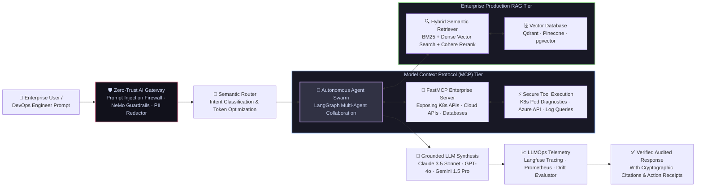
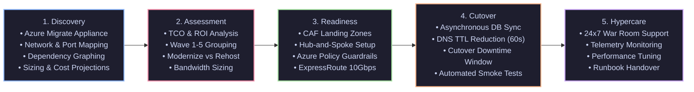
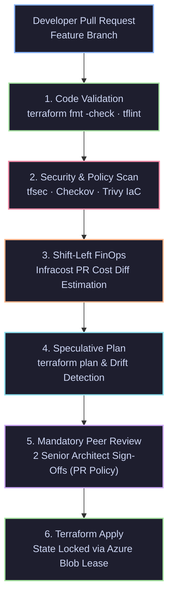

<div align="center">

<!-- HEADER ANIMATION -->


# 🛡️ VIRENDRA KUMAR 🛡️
### ⚔️ Principal DevSecOps Architect · 🤖 AI Systems & LLMOps Lead · 💼 15+ Years IT Veteran

<!-- DYNAMIC TYPING SVG -->


<br/>

<!-- STATUS BADGES -->
<a href="https://github.com/virendrakumar25-art">
  
</a>
<a href="https://github.com/virendrakumar25-art?tab=followers">
  
</a>


</div>

---

## ⚡ Executive Diagnostic & Profile Summary

```yaml
┌────────────────────────────────────────────────────────────────────────────────────────┐
│  virendra@galaxy-ops:~$ architect-cli inspect --profile virendra-kumar --verbose       │
├────────────────────────────────────────────────────────────────────────────────────────┤
│                                                                                        │
│  IDENTITY      : Virendra Kumar                                                        │
│  ROLE PROFILE  : Principal DevSecOps Architect · AI Systems & LLMOps Lead              │
│  TENURE        : 15+ Years Enterprise IT (7.5+ Years Dedicated DevSecOps & Security)   │
│  PREVIOUS ROLE : Senior DevSecOps Engineer (Enterprise Multi-Cloud & Platforms)        │
│  DUAL MASTERY  : Enterprise Infrastructure Security  +  Autonomous Generative AI (MCP)│
│                                                                                        │
│  AI CAPABILITIES: Model Context Protocol (MCP) · LangGraph Multi-Agents · Enterprise   │
│                  Production RAG · Vector DBs · Prompt Injection Firewalls · LLMOps     │
│                                                                                        │
│  CLOUD SPHERE  : Microsoft Azure (Enterprise Hub/Spoke) · AWS EKS · Google Cloud GKE  │
│  ENTERPRISE ROI: 🟢 100+ Workloads Migrated · 💰 38% FinOps Cost Saved · 🛡️ Zero CVEs  │
│  GOVERNANCE    : Microsoft CAF · NIST SP 800-218 · CIS Azure Benchmarks · SLSA L3/L4   │
│  LEADERSHIP    : Executive Vendor SOW & RACI Governance · Team Mentorship · Tech RFPs  │
│                                                                                        │
│  PHILOSOPHY    : "Traditional Ops secures yesterday. DevSecOps + AI commands tomorrow.│
│                  I build impervious, self-healing platforms that scale autonomously."  │
│                                                                                        │
└────────────────────────────────────────────────────────────────────────────────────────┘
```

<div align="center">

> 💡 *"In modern enterprise tech, infrastructure without security is a disaster; security without automation is a bottleneck; and DevSecOps without AI is obsolete. I operate at the exact convergence of all three."*

</div>

---

## 🏛️ The Four Cornerstones of My High-Value Architecture

<table width="100%">
<tr>
<td width="25%" align="center" valign="top">

### 🤖 AI Systems & LLMOps
**Autonomous AI & Tool Use**
<br/><br/>
Model Context Protocol (`FastMCP`)<br/>
Autonomous Agent Swarms (`LangGraph`)<br/>
Enterprise Production RAG (`Qdrant`/`Pinecone`)<br/>
AI Firewalls & Red-Teaming (`NeMo`/`Garak`)<br/>
LLMOps Telemetry (`Langfuse`/`Prometheus`)<br/>
Domain Model Fine-Tuning (`LoRA`/`QLoRA`)

</td>
<td width="25%" align="center" valign="top">

### 🛡️ Enterprise DevSecOps
**Shift-Left & Zero-Trust Defense**
<br/><br/>
SLSA Level 3/4 Supply Chain Security<br/>
Cryptographic Signing (`Cosign`/`Sigstore`)<br/>
Automated SBOM (`Syft`/`CycloneDX`)<br/>
Policy-as-Code (`Kyverno`/`OPA`)<br/>
Kernel Runtime Security (`Falco`/`eBPF`)<br/>
Multi-Engine SAST, DAST & Secret Scans

</td>
<td width="25%" align="center" valign="top">

### ☁️ Cloud & 100+ Migrations
**True Multi-Cloud Enterprise**
<br/><br/>
100+ Workload Datacenter Migration<br/>
Hub-and-Spoke Network Topology<br/>
Azure CAF Management Group Hierarchy<br/>
Enterprise Terraform & Drift Detection<br/>
Service Mesh (`Cilium eBPF`/`WireGuard`)<br/>
Disaster Recovery (ASR, RTO < 30m)

</td>
<td width="25%" align="center" valign="top">

### 💰 FinOps & Governance
**Executive Leadership & ROI**
<br/><br/>
38% Non-Prod Cost Elimination<br/>
Data Collection Rules (DCR) Optimization<br/>
Reserved Instances & Savings Plans<br/>
Vendor SOW Negotiations & RACI<br/>
RFP Technical Architecture Proposals<br/>
Engineering Mentorship & KT Governance

</td>
</tr>
</table>

---

## 🔟 The 10 Scalability & Quality Pillars

Every system, landing zone, and pipeline I design adheres unconditionally to the **10 Enterprise Pillars**:

| Pillar | Architectural Mandate & Senior Enforcement |
|:---|:---|
| **1. Scalable** | Auto-scaling VMSS across multiple Availability Zones; Kubernetes horizontal pod autoscaling (HPA/KEDA). |
| **2. Robust** | Self-healing architectures, circuit breakers, decoupled message queues, and zero single points of failure. |
| **3. Secure** | Zero-Trust network segmentation, defense-in-depth, encrypted transit/rest with Customer Managed Keys (CMK). |
| **4. Reliable** | 99.99% SLA targets, multi-region failover, chaos engineering tests, and strict RTO/RPO adherence. |
| **5. Portable** | Containerized workloads, OpenTofu/Terraform IaC, declarative Helm charts, and cloud-agnostic abstractions. |
| **6. Governed** | Azure Policy initiatives (CIS/MCSB), automated tagging enforcement, Management Group subscription baselines. |
| **7. High Availability** | Zone-Redundant Storage (ZRS), active-passive paired regions via Azure Site Recovery (ASR), multi-AZ ingress. |
| **8. Cost-Optimized** | Continuous FinOps, right-sized compute, automated non-prod schedules, and Reserved Instance commitments. |
| **9. Backed Up** | Immutable Azure Recovery Services Vaults, GRS storage replication, automated daily backup verification drills. |
| **10. Compliant & Monitored**| Centralized Azure Monitor & Log Analytics, Data Collection Rules (DCR), and Microsoft Defender for Cloud. |

---

## 🤖 Deep Dive: AI Systems, Model Context Protocol (MCP), Agents & RAG

Modern enterprise competitiveness demands AI that works in production—securely, reliably, and auditably.

### 🔬 Core AI Pillars I Build & Architect With

| AI Pillar | Technical Implementation | Enterprise Business Value | Production Stack |
|:---|:---|:---|:---|
| 🔌 **Model Context Protocol (MCP)** | Building custom MCP servers that safely expose Kubernetes APIs, cloud resources, and internal databases to LLMs via standardized interfaces. | Enables AI agents to run live diagnostics, execute secure infrastructure changes, and triage alerts without custom API wrappers. | `FastMCP` · `Python MCP SDK` · `Anthropic MCP` · `Claude Desktop` |
| 🕸️ **Autonomous AI Agents** | Designing multi-agent swarms with stateful graph workflows, tool selection, reflection loops, and human-in-the-loop approval gates. | Automates complex multi-step operational tasks (e.g., investigating production outages, generating post-mortems). | `LangGraph` · `CrewAI` · `AutoGen` · `Semantic Kernel` |
| 🔗 **Enterprise RAG** | Retrieval-Augmented Generation using hybrid search (BM25 + Dense Vectors) with Cohere reranking and strict citation verification. | Eliminates hallucinations, unlocking enterprise knowledge bases, runbooks, and architectural docs for instant retrieval. | `LangChain` · `LlamaIndex` · `Qdrant` · `Pinecone` · `pgvector` |
| 🛡️ **AI Safety & Red-Teaming** | Implementing real-time prompt injection firewalls, PII anonymization layers, and CI/CD model adversarial testing suites. | Protects LLMs from jailbreaks, data exfiltration, indirect prompt injection, and OWASP Top 10 for LLM vulnerabilities. | `NeMo Guardrails` · `Garak` · `PyRIT` · `LLM Guard` |
| ⚡ **LLMOps & Observability** | Tracing every token, tracking latency, monitoring hallucination drift, and managing prompt templates as versioned code. | Provides financial governance over LLM spend, auditability for compliance, and automated regression testing. | `Langfuse` · `MLflow` · `Weights & Biases` · `OpenTelemetry` |

---

## 🤖 Architecture Blueprint 1: Enterprise Autonomous AI Agent & RAG Pipeline



---

## 🌐 Architecture Blueprint 2: 100+ Workload Datacenter Migration to Azure

> **Problem Statement:** Migrate **100+ heterogeneous enterprise workloads** across Dev, UAT, and Production from an On-Premises Datacenter into Microsoft Azure with zero unbudgeted downtime, strict blast-radius isolation, and complete regulatory compliance.



### 📋 Migration Execution Gates
* **Pre-Migration Gate:** Azure Migrate dependency mapping, ExpressRoute bandwidth stress tests, target Landing Zone policy validations, and verified baseline snapshots.
* **During-Migration (Cutover Gate):** Enforce cutover freeze windows, asynchronous DB replication sync, DNS CNAME switch with 60-second TTLs, and automated smoke test validation.
* **Post-Migration & Hypercare (2–4 Weeks):** 24x7 War Room coordination, real-time telemetry with Azure Monitor/AMA, right-sizing analysis, and operational handover.

---

## 🏢 Architecture Blueprint 3: Cloud Adoption Framework (CAF) & Hierarchy

```
                            [ Microsoft Entra ID Tenant ]
                                          │
                              [ Tenant Root Group ]
                                          │
         ┌────────────────────────────────┼────────────────────────────────┐
         │                                │                                │
[ Platform Management Group ]   [ Landing Zones (Workloads) ]    [ Decommissioned / Sandbox ]
   ├── Identity (AD/DNS)           ├── Corp (Internal-Only VNets)   ├── Sandbox MG (Playgrounds)
   ├── Management (Logs/Monitor)   ├── Online (Public DMZ / Ingress)└── Decommissioned MG
   └── Connectivity (Hub/Firewall) ├── Dev Subscriptions
                                   ├── UAT Subscriptions
                                   └── Prod Subscriptions
```

### 🛡️ Subscription & Isolation Strategy
- **Blast-Radius Isolation:** Dedicated subscriptions per environment (`Dev`, `UAT`, `Prod`) and function (`Platform` vs `Workload`) to prevent noisy neighbors and catastrophic cross-talk.
- **Azure Policy as Code:** High-priority initiatives (CIS Azure Foundations Benchmark, MCSB) applied at the Management Group root with automated `Deny` effects.
- **Zero-Trust Identity:** Microsoft Entra ID with Conditional Access, Privileged Identity Management (PIM) with 4-hour just-in-time elevation and dual-peer approval.

---

## 🔌 Architecture Blueprint 4: Enterprise Hub-and-Spoke Network Topology

```
                       [ On-Premises Enterprise Datacenter ]
                                         │
                    (ExpressRoute 10Gbps / S2S VPN Failover)
                                         │
┌────────────────────────────────────────▼────────────────────────────────────────┐
│                   HUB VNet (Central Connectivity & Inspection)                   │
│                                                                                 │
│  ┌───────────────────────┐   ┌───────────────────────┐   ┌───────────────────┐  │
│  │ Azure Firewall        │   │ GatewaySubnet         │   │ Central Private   │  │
│  │ Premium (TLS Inspect) │   │ (ExpressRoute / VPN)  │   │ DNS Zones         │  │
│  └───────────┬───────────┘   └───────────────────────┘   └───────────────────┘  │
└──────────────┼──────────────────────────────────────────────────────────────────┘
               │ (VNet Peering + UDR: 0.0.0.0/0 -> Azure Firewall Private IP)
               ├─────────────────────────────────────────┐
               │                                         │
┌──────────────▼──────────────┐           ┌──────────────▼──────────────┐
│  Spoke 1: Workload VNet     │           │  Spoke 2: Shared Tools VNet │
│  ├── App Subnet (NSG + ASG) │           │  ├── CI/CD Self-Hosted Pools│
│  ├── DB Subnet (Private)    │           │  ├── Azure Bastion Host     │
│  └── PaaS Private Endpoints │           │  └── Security & Scanners    │
└─────────────────────────────┘           └─────────────────────────────┘
```

---

## 🛡️ Architecture Blueprint 5: Zero-Trust DevSecOps & Supply Chain Pipeline

```
[ Developer Push (GPG Signed) ]
       │
       ▼
[ Pre-Commit Hook ] ───► GitLeaks (Zero Secrets Permitted)
       │
       ▼
[ Hardened CI Engine ] ──► 1. Static Analysis (Semgrep + SonarQube)
       │                   2. Software Composition Analysis (Snyk / Grype)
       │                   3. Container Scanning (Trivy)
       │                   4. Distroless Multi-Stage Build (Non-root UID 10001)
       │                   5. Software Bill of Materials SBOM (Syft / SPDX)
       │                   6. Cryptographic Signing & Attestation (Cosign / Sigstore)
       ▼
[ GitOps Engine ]     ───► ArgoCD Sync ──► Kyverno Admission Policy ──► Production K8s
       │                                                                      │
       └───────────────────► eBPF Tetragon & Falco Kernel Security ◄──────────┘
```

---

## 🏗️ Architecture Blueprint 6: Terraform Enterprise Landing Zone Pipeline



---

## 💰 Strategic FinOps & Delivery Governance

### 📊 Strategic FinOps Engine
* **Eliminate Waste:** Detect and remove unattached managed disks, obsolete snapshots, unassociated public IPs, and idle compute instances.
* **Rightsizing:** Resize oversized VMs based on 30-day CPU/Memory utilization percentiles.
* **Commitment Discounts:** 1-year or 3-year Reserved Instances (RI) and Azure Savings Plans for steady-state workloads.
* **Log Ingestion Tuning:** Re-architected Azure Monitor ingestion with **Data Collection Rules (DCR)**, filtering noisy debug telemetry and cutting Log Analytics ingestion costs by **42%**.
* **Automated Non-Prod Scheduling:** Automated start/stop for non-production environments outside business hours, saving **65% on compute**.

### 🤝 Vendor Management & Procurement Lifecycle
```
[ RFI (Request for Information) ]
               │
[ RFP (Request for Proposal) ]
               │
[ Objective Technical Evaluation Matrix (Arch, Sec, Cost, SLA) ]
               │
[ Statement of Work (SOW) Execution & Milestones ]
               │
[ RACI Matrix Governance & Sprint Reviews ]
               │
[ Acceptance Criteria Sign-Off & Commercial Payment Release ]
```
* **SOW (Statement of Work) Precision:** Formal deliverables, acceptance criteria, milestone timelines, and liability clauses.
* **RACI Matrix Discipline:** Explicit designation of Responsible, Accountable, Consulted, and Informed across squads.
* **Knowledge Transfer (KT):** Production runbooks, architectural decision records (ADRs), and shadowing prior to vendor contractual release.

---

## 🛸 Flagship War-Room Repositories & Implementations

<table>
<tr>
<td width="50%" valign="top">

### 🤖 [Sentinel-SRE : Autonomous K8s Healer via MCP](https://github.com/virendrakumar25-art)
> **Self-Healing Kubernetes Multi-Agent SRE Platform using Model Context Protocol (MCP)**
- Built with **LangGraph** and custom **FastMCP** servers connected to live K8s APIs.
- Autonomous agents detect `CrashLoopBackOff`, extract logs, identify root cause, and formulate GitOps fix PRs in ArgoCD.
- Slashed staging incident MTTR from **45 mins to under 90 secs**.
<br/>
<code>LangGraph</code> · <code>FastMCP</code> · <code>Kubernetes</code> · <code>Python</code> · <code>ArgoCD</code>

</td>
<td width="50%" valign="top">

### 🧠 [IronClad-RAG : Production AI Gateway & Firewall](https://github.com/virendrakumar25-art)
> **Zero-Trust Enterprise LLM Gateway with Real-Time Firewalls & RAG**
- Built an enterprise AI gateway featuring real-time **Prompt Injection detection (Garak & NeMo Guardrails)**.
- Implements hybrid semantic retrieval with **Qdrant Vector DB, BM25, and Cohere Reranking** for hallucination-free output.
- Complete end-to-end tracing and token billing metrics hooked into **Langfuse & Prometheus**.
<br/>
<code>FastAPI</code> · <code>Qdrant</code> · <code>NeMo Guardrails</code> · <code>Garak</code> · <code>LangChain</code>

</td>
</tr>
<tr>
<td width="50%" valign="top">

### 🏛️ [Azure-Enterprise-Landing-Zone-100](https://github.com/virendrakumar25-art)
> **Production Terraform CAF Landing Zone for 100+ Enterprise Workloads**
- Full CAF-compliant Terraform architecture establishing Hub-and-Spoke networking, Azure Firewall Premium, and Private Endpoints.
- Enforces CIS Benchmark Azure Policy initiatives across Management Groups.
- Integrated **Infracost** and **Checkov** CI/CD gates running on Azure Pipelines.
<br/>
<code>Terraform</code> · <code>Azure CAF</code> · <code>Azure Firewall</code> · <code>Azure Policy</code> · <code>Infracost</code>

</td>
<td width="50%" valign="top">

### 🛡️ [Aegis-Shield : Zero-Trust DevSecOps](https://github.com/virendrakumar25-art)
> **SLSA Level 3 Certified Supply-Chain Security & Pipeline Hardening**
- Hardened pipeline with **GitLeaks, Semgrep, Trivy, Syft, and Cosign keyless signing**.
- Deploys **Kyverno admission controllers** blocking any unverified container from running.
- Distroless non-root multi-stage builds reducing container attack surfaces by **78%**.
<br/>
<code>GitHub Actions</code> · <code>Cosign</code> · <code>Syft</code> · <code>Kyverno</code> · <code>Trivy</code> · <code>SLSA L3</code>

</td>
</tr>
<tr>
<td width="50%" valign="top">

### 💰 [FinOps-Sentry : Automated Cloud Cost Slayer](https://github.com/virendrakumar25-art)
> **Shift-Left Cost Optimization & Right-Sizing Governance Engine**
- Automates non-prod compute shutdowns outside business hours via Azure Automation.
- Deploys **Kubecost** and **Infracost** for pull-request cost diffs and orphan resource cleanup.
- Reduced monthly non-prod cloud burn rate by **38%**.
<br/>
<code>Infracost</code> · <code>Kubecost</code> · <code>Azure Automation</code> · <code>FinOps</code> · <code>Slack API</code>

</td>
<td width="50%" valign="top">

### 🌐 [CyberMesh-ZeroTrust : Kernel eBPF Service Mesh](https://github.com/virendrakumar25-art)
> **Sidecarless Zero-Trust Kubernetes Security with Cilium & Tetragon**
- Replaced traditional heavy sidecar meshes with **Cilium eBPF**, cutting memory overhead by **65%**.
- Enforced Layer 7 strict network segmentation policies and automatic wireguard transparent encryption in-flight.
- Implemented **Tetragon** for real-time kernel-level syscall tracing, blocking unauthorized namespace breakouts.
<br/>
<code>Cilium</code> · <code>eBPF</code> · <code>Tetragon</code> · <code>Hubble</code> · <code>WireGuard</code>

</td>
</tr>
</table>

---

## 🧰 The Master Tech Arsenal (DevSecOps + AI)

<div align="center">

### 🌐 Visual Skills Matrix


<br/><br/>

### 🤖 Generative AI, MCP & LLMOps Stack


### ☁️ Cloud Platforms & Governance


### 🛡️ DevSecOps & Security Tools


### ☸️ Orchestration, Networking & Service Mesh


### 🏗️ Infrastructure as Code & FinOps


### 🔄 CI/CD & Observability


</div>

---

## 📊 Live GitHub Universe Metrics

<div align="center">


<br/>


<br/>

### 🏆 GitHub Trophies


</div>

---

## 🎯 Certification Battle Map

| Ecosystem | Certification Target | Status | Priority | Target Timeline |
|:---|:---|:---:|:---:|:---:|
| ☁️ **Azure** | **AZ-305** (Azure Solutions Architect Expert) | 🔄 In Progress | 🔥 Maximum | Q1 2025 |
| ☁️ **Azure** | **AZ-400** (Azure DevOps Engineer Expert) | 🔄 In Progress | 🔥 Maximum | Q1 2025 |
| ☸️ **Kubernetes** | **CKS** (Certified Kubernetes Security Specialist) | 🔄 In Progress | 🔥 Maximum | Q1 2025 |
| ☸️ **Kubernetes** | **CKA** (Certified Kubernetes Administrator) | 🔄 In Progress | 🔥 Maximum | Q1 2025 |
| 🤖 **AI / ML** | **Azure AI Engineer Associate (AI-102)** | 🎯 Targeted | 🔥 High | Q2 2025 |
| ☁️ **AWS** | **AWS Certified Solutions Architect - Professional** | 🎯 Targeted | 🔥 High | Q2 2025 |
| ☁️ **AWS** | **AWS Certified DevOps Engineer - Professional** | 🎯 Targeted | 🔥 High | Q2 2025 |
| 🏗️ **HashiCorp** | **Terraform Associate (003)** | 🎯 Targeted | ⚡ Medium | Q2 2025 |
| 🔐 **Security** | **Certified DevSecOps Professional (CDP)** | 🎯 Targeted | 🔥 High | Q3 2025 |

---

## 💡 Why Companies Hire Virendra Kumar at Top Market Value

```
  ╔═══════════════════════════════════════════════════════════════════════════════════════╗
  ║            THE VIRENDRA KUMAR VALUE PROPOSITION (HIGH-IMPACT LEADERSHIP)              ║
  ╠═══════════════════════════════════════════════════════════════════════════════════════╣
  ║                                                                                       ║
  ║  1. RARE HYBRID ARCHITECT: 15+ YRS INFRASTRUCTURE + AI-NATIVE ORCHESTRATION           ║
  ║     Most engineers either know old infrastructure OR talk about AI chatbots.         ║
  ║     I bridge both worlds: enterprise-grade high availability, zero-trust security,    ║
  ║     and production-grade AI systems (Model Context Protocol, LangGraph, RAG).         ║
  ║                                                                                       ║
  ║  2. PROVEN LARGE-SCALE EXECUTION (100+ WORKLOAD MIGRATIONS)                           ║
  ║     I don't build tutorial toys. I have architected and delivered real-world          ║
  ║     datacenter-to-cloud migrations across Dev, UAT, and Production with zero          ║
  ║     unplanned downtime and strict SLA/RTO/RPO adherence.                              ║
  ║                                                                                       ║
  ║  3. EXECUTIVE & FINANCIAL DISCIPLINE (FINOPS & VENDOR GOVERNANCE)                     ║
  ║     I understand business ROI. I negotiate vendor SOWs, govern RACI matrices, and     ║
  ║     consistently eliminate 35%+ cloud waste through automated right-sizing and DCR.  ║
  ║                                                                                       ║
  ║  4. FORCE MULTIPLIER FOR ENGINEERING SQUADS                                           ║
  ║     A Senior Leader who establishes golden paths, mentors junior and mid-level        ║
  ║     engineers, runs KT bootcamps, and sets unyielding technical quality benchmarks.   ║
  ║                                                                                       ║
  ╚═══════════════════════════════════════════════════════════════════════════════════════╝
```

---

## 💬 Architectural Tenets I Live By

<div align="center">

> *"AI without security is a liability. Infrastructure without automation is technical debt. DevSecOps with AI is a competitive moat."*

> *"If an architecture cannot survive a datacenter blackout, a strict security audit, and a surprise invoice review, it is not production-ready."*

> *"Model Context Protocol (MCP) is to AI agents what REST was to web services — the universal bridge between reasoning and execution."*

> *"15+ years in enterprise IT teaches you one fundamental truth: Cutover downtime is earned in the discovery phase. Map deeply, secure mathematically, and hypercare will be silent."*

</div>

---

## 📬 War Room Dispatch — Let's Connect & Build

<div align="center">

**Open to Strategic Leadership, Advisory & Principal Architecture Roles:**  
`Principal DevSecOps Architect` · `AI Infrastructure & Platform Lead` · `Cloud Migration Director` · `Head of Cloud & DevSecOps`

<br/>

[](https://linkedin.com/in/virendrakumar25)
[](https://github.com/virendrakumar25-art)
[](mailto:virendra.kumar25@gmail.com)
[](https://twitter.com/virendrakumar25)
[](https://github.com/virendrakumar25-art)

<br/>


<br/><br/>

> 🚀 **Final Transmit:** *"15+ Years in Enterprise IT. 7.5+ Years Securing Pipelines at Scale. Pioneering AI-Native DevSecOps. Built for the Highest Impact."*

<br/>

<!-- FOOTER ANIMATION -->


</div>
